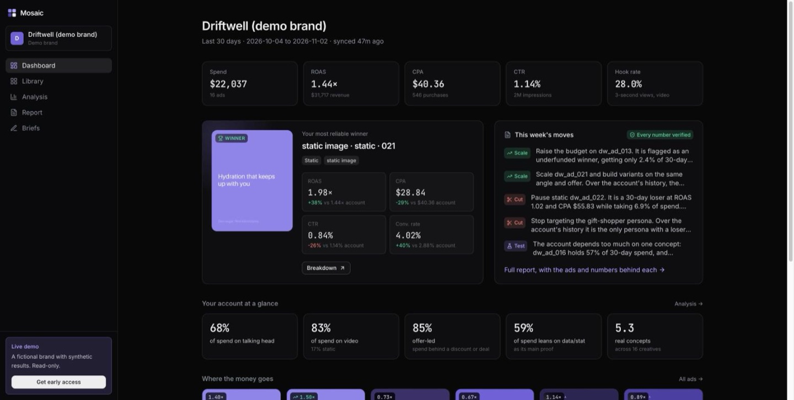
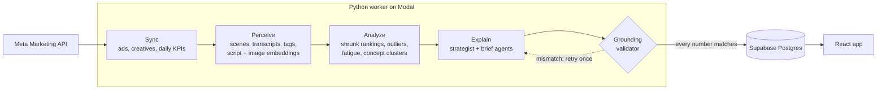
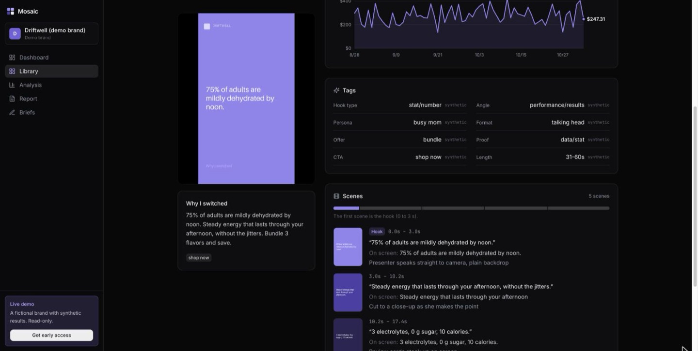
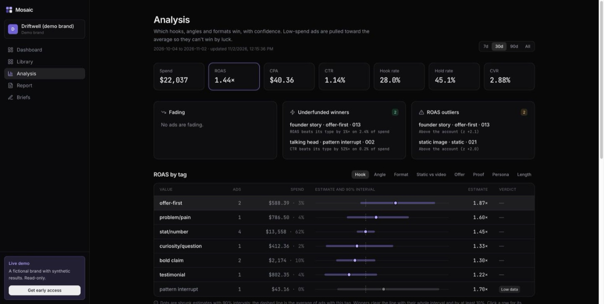
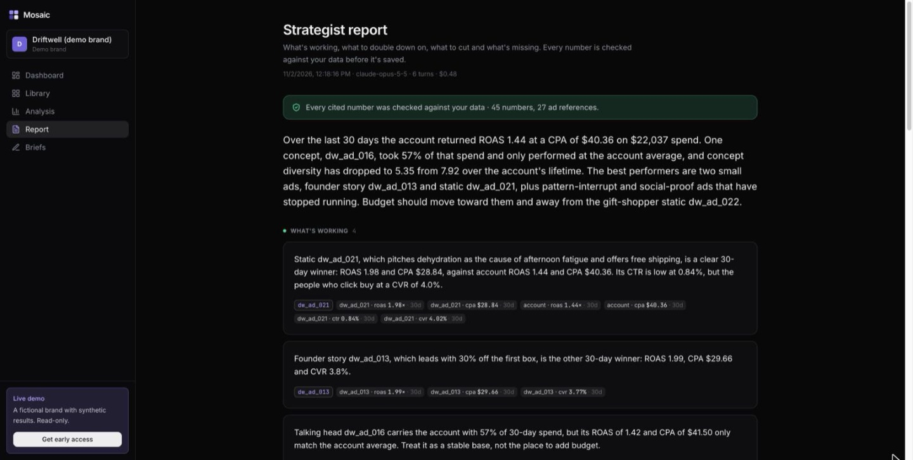

# Mosaic

**An AI creative strategist for Meta ads.** Connect an ad account and Mosaic imports every ad, breaks each creative down scene by scene with vision models, ties the tags to performance, and turns that into guidance: what's working, what to double down on, what to cut, and briefs for the next tests. Every claim cites the ads and numbers behind it.

Built as a solo applied-AI project. The target is a deployed, demo-ready MVP by December 2026. Current status is tracked in [docs/ARCHITECTURE.md](docs/ARCHITECTURE.md) §2.

**Live:** [mosaicads.vercel.app](https://mosaicads.vercel.app)

[](https://github.com/carsonturnr/mosaic/actions/workflows/ci.yml)
[](LICENSE)



## What you get

- **A dashboard that says what to do.** The account's most reliable winner, with each metric against the account average; this week's moves (scale, cut, test) from the latest report; and plain facts about where the money goes ("68% of spend on talking head", "5.3 real concepts").
- **Every ad broken down.** Hook, angle, persona, format, offer, proof and CTA for video and static, plus a scene-by-scene timeline where the first 3 seconds are their own scene.
- **Rankings you can trust.** Tags ranked by ROAS, CPA, CTR, hook rate and more, with 90% intervals, so a lucky low-spend ad can't top the table.
- **A strategist report and briefs.** Written by Claude from the analysis, with every number checked against the database before it's saved. "Make variations" turns the winning ad into a brief.
- **Brand memory from a link.** Paste the brand's website and Mosaic drafts its product, audience, voice and claims to avoid for briefs to follow. When a site blocks automated reads, it falls back to web research.

## How it works

One pipeline: **sync → perceive → analyze → explain.** Each stage writes structured rows to Postgres, and later stages never re-read raw media.



1. **Sync.** Campaigns, ad sets, ads, creatives and daily KPIs come from the Meta Marketing API on a schedule (every 4 hours, plus a nightly 28-day restatement). Everything goes through one `DataSource` interface, which also runs on a Meta sandbox account with synthetic results and on a local demo fixture.
2. **Perceive.** Each video is split into scenes with a forced boundary at 3 seconds, so the hook is always its own segment. Gemini watches the whole video and returns schema-validated tags with confidence: hook type, angle, persona, format, offer, proof type and CTA. Scripts and keyframes are embedded for similarity.
3. **Analyze.** Tag values are ranked by KPI with empirical-Bayes shrinkage, so a low-spend ad can't win by luck. The analysis also covers static vs. video, weekly trends, robust-z outliers within peer groups, fading ads, and underfunded winners. Near-duplicate ads are clustered into concepts, and the spend-weighted diversity score says how many real ideas the account is running.
4. **Explain.** A strategist agent and a brief generator (Claude) call typed, read-only tools over the analytics layer. Every claim has to cite ad IDs and metric values. A grounding validator checks each cited number against the database before anything is saved.

| Ad breakdown | Analysis | Report |
| --- | --- | --- |
|  |  |  |

Screenshots are from an earlier demo workspace for a fictional brand; its results are synthetic.

## Results

The latest nightly eval run (also shown on the in-app Evals page):

| Eval | How it's measured | Result |
| --- | --- | --- |
| Planted problems | The synthetic generator plants a winning hook, fading ads, near-duplicates, a static-vs-video gap and a hidden low-spend winner. The analysis must surface each one. Gated in CI. | 100% on 8 seeded accounts |
| Grounding | Every number cited in a strategist report or brief is checked against the database. | 100% (131 numbers across 4 reports) |
| Tagging accuracy | AI tags vs. blind hand labels on real public ads, per field. | Early: mean F1 0.59 on 10 labeled ads. Format and offer are at 90% accuracy; hook type and angle are the hard ones. The labeled set is growing. |

## Design decisions

- **Synthetic data with an answer key.** Meta sandbox accounts never deliver, so they have no results. Rather than fake a dashboard, a deterministic generator layers realistic daily KPIs onto the ads' own tags and records the patterns it plants. Those patterns double as the eval answer key.
- **Shrinkage before ranking.** Rates use a beta-binomial prior, and CPA and ROAS use gamma-Poisson estimates. Priors are capped at the weight of one typical ad. A tag only counts as a "winner" if its whole 90% interval clears the average by at least 10%.
- **Citations as data.** Agents submit claims as `{claim, ad_ids, metrics: [{entity, metric, value, window}]}`, so every number points at a specific row and can be checked mechanically.
- **One LLM wrapper.** Every model call goes through one wrapper, which handles schema validation with one retry, backoff, a content-hash cache (unchanged creatives are never re-tagged) and Langfuse tracing.
- **Concepts, not ads.** Similar ads are grouped on key tags plus script and image embeddings, so 22 variations of one idea count as one concept.

## Stack

| Layer | Choice |
| --- | --- |
| Web | React 19, Vite, TypeScript (strict), Tailwind v4, Vercel |
| Data | Supabase (Postgres + pgvector, Auth, Storage, Vault) |
| Workers | Python 3.12, FastAPI, Modal (cron + queues) |
| Perception | Gemini Flash (video + image), Gemini embeddings (text + image), ffmpeg + PySceneDetect |
| Agents | Claude with tool use and structured outputs |
| Tracing and evals | Langfuse |

## Repository layout

```
web/        React app: marketing site, auth, creative library, dashboards
worker/     Python package `mosaic`: data sources, sync, perception, analytics, agents
supabase/   migrations and seed SQL
evals/      labeled sets, eval runners, planted-pattern answer key
docs/       MVP spec, architecture, screenshots
scripts/    seeding and one-off tools
```

## Development

Requirements: Node 22, [uv](https://docs.astral.sh/uv/), the [Supabase CLI](https://supabase.com/docs/guides/cli).

```bash
git clone https://github.com/carsonturnr/mosaic && cd mosaic
cp .env.example .env && cp web/.env.example web/.env   # fill in Supabase keys

# database
supabase link --project-ref <your-project-ref>
supabase db push --include-seed

# worker
cd worker && uv sync
uv run pytest
uv run python -m mosaic.seed --owner-email you@example.com   # synthetic workspace
uv run uvicorn mosaic.api:app --reload --port 8000

# web
cd ../web && npm install && npm run dev
```

The synthetic data generator plants known patterns (a winning hook type, fatiguing ads, near-duplicates, a hidden low-spend winner) and writes them to `evals/answer_key.json`, so the analysis layer can be tested without spending on ads.

## Documents

- [docs/MOSAIC_MVP.md](docs/MOSAIC_MVP.md): product spec and success criteria
- [docs/ARCHITECTURE.md](docs/ARCHITECTURE.md): architecture, data model, analytics and conventions

## Contributing and security

See [CONTRIBUTING.md](CONTRIBUTING.md) and [SECURITY.md](SECURITY.md).

## License

MIT. See [LICENSE](LICENSE).
